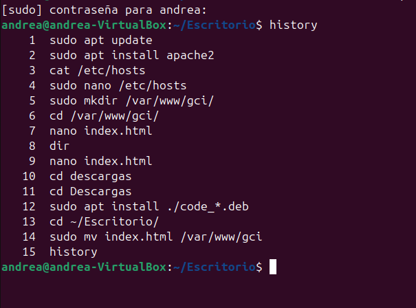
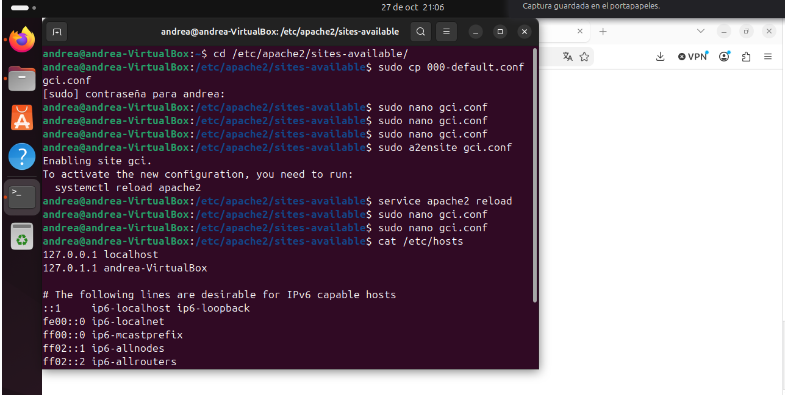
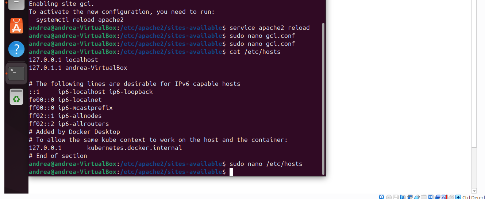
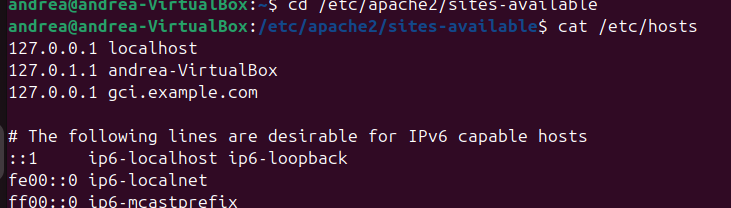

## APACHE EJERCICIOS
### INTRODUCCIÓN
Apache es un software web que sirve para administrar un servidor y alojar páginas web y se las devuelve al cliente mediante el protocolo HTTP o HTTPS. Es popular debido a su compatibilidad con sistemas operativos como son Windows o Linux. Utiliza archivos de texto plano como httpd.conf y archivos de configuración por directorio .htaccess. La versión más actual es la 2.4.69 a día 27 de octubre de 2026. Su estructura permite activar o desactivar módulos según las necesidades, como por ejemplo necesidades de seguridad

### RELACIÓN DE LAS ACTIVIDADES REALIZADAS

A modo de usuario se instalará Apache con la motivación de poder ver páginas web sin la necesidad de contratar servicios de alojamiento web, poder testear fallos entre otras

### PASOS A SEGUIR
- Actualizamos el pc (Instrucción 1)
- Hacemos un sudo para instalar apache (Instrucción 2)
- Creamos la carpeta necesaria en var/www  (Instrucción 5)
- Hacemos el archivo de index y lo rellenamos (En este caso se hizo en VSC porque no recordaba que tenía que poner sudo antes de editar un archivo)  (Instrucción 7)
- Movemos el archivo a las carpetas gci (Instrucción 14)

  
  
- En el directorio etc apache2 sites-available hay que copiar otro archivo para adecuarlo a la nueva web

  

- Hay que configurarlo cambiando DocumentRoot poniendo nuestra dirección /var/www/gci/ y añadiendo la dirección "web" del lugar ServerName gci.example.com
- Hay que cambiar el etc/hosts para que admita nuestra ruta

  

  
  
- Por último hay que probar que la configuración funciona

  

### CONCLUSIÓN
Hay muchos pasos a seguir en la instalación de Apache y no hacerlos bien puede traer dolores de cabeza innecesarios, incluso si a primeras suena sencillo
