## APACHE HTTPS
### INTRODUCCIÓN
#### QUÉ ES HTTPS
HTTPS es el protocolo seguro de HTTP, su función principal es cifrar tus datos.
Al escribir una URL o entrar a una web, tu navegador se comunica con el servidor a través del puerto 443 y el servidor envía al
navegador su certificado oficial SSL/TLS. Este documento digital acredita que el sitio web es legítimo y pertenece a quien dice ser.
El navegador comprueba que el certificado sea válido, esté vigente y pertenezca al dominio al que intentas acceder.
El navegador usa dos tipos de cifrado:
- Cifrado asimétrico: Al inicio, se utiliza una clave pública y privada para acordar una clave compartida de forma segura.
- Cifrado simétrico: Una vez acordada esa clave única para la sesión, toda la transferencia de datos posterior se cifra y descifra con ella.
Si un atacante intercepta la información por el camino, solo verá caracteres ilegibles y sin sentido.

### CERTIFICADOS SSL Y TLS
• SSL (Secure Sockets Layer): Protocolo original (90s) actualmente obsoleto y se considera inseguro.
• TLS (Transport Layer Security): Es el sucesor moderno y seguro de SSL.

Su función principal es cifrar los datos y aunque SSL no se usa a día de hoy, siendo el estándar el TLS, sigue siendo mencionado como el protocolo de seguridad estándar.

### INICIAR SSL o TLS EN APACHE
Para inicia el ssl en Apache se usa mod_ssl. Aunque se llame Ssl también activa TLS
Se tiene que usar el a2enmod que sirve para administrar modificaciones.

### PASOS A SEGUIR
Miramos el estado de Apache
sudo para ejecutar como administrador
systemctl sirve para administrar algo del ordenador
status para indicar que quiero saber el estado

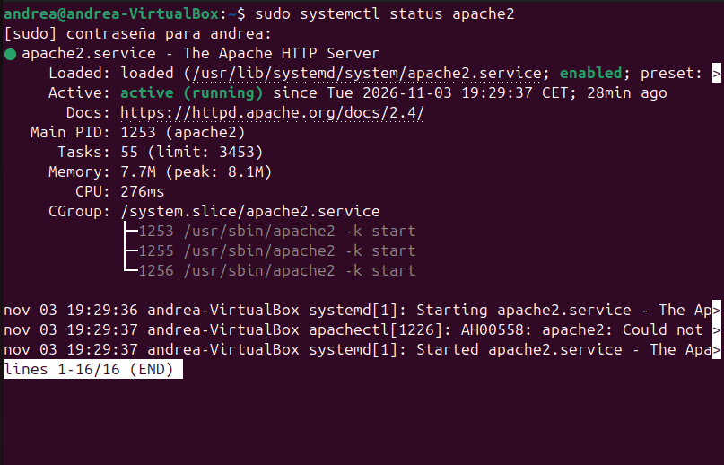

Para instalar cosas en apache hay que usar el a2enmod, seguido de lo que queremos usar, en este caso se usará ssl y headers después de a2enmod
sudo a2enmod ssl
sudo a2enmod headers

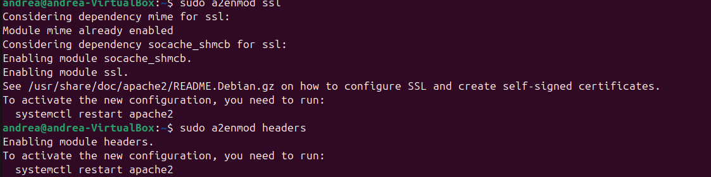

Y reiniciamos apache con la misma estructura que en el estado pero con restart

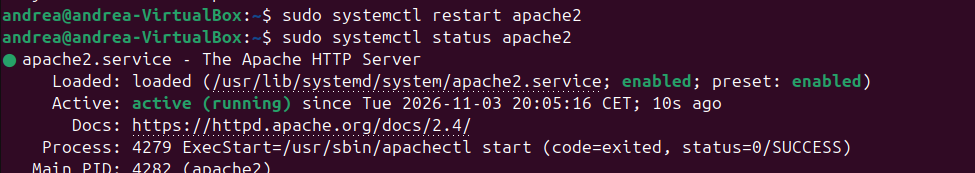

Con el siguiente comando podemos generar un certificado para uso personal y local:
sudo openssl req -x509 -nodes -days 365 -newkey rsa:2048 -keyout /etc/ssl/private/apache-selfsigned.key -out /etc/ssl/certs/apache-selfsigned.crt

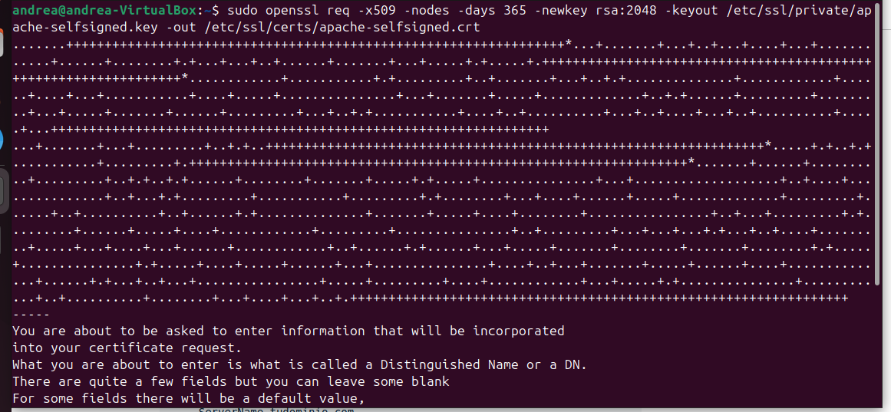

En un archivo destinado a SSL de etc/hosts/sites-available hay que añadir la URL de nuestro sitio web

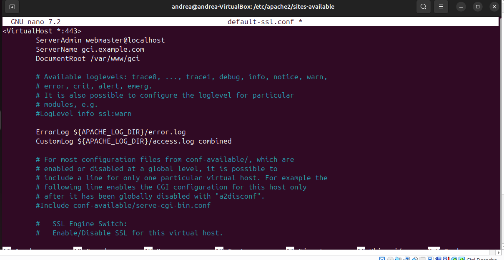

Y después de configurarlo, se habilita el sítio y se reinicia apache

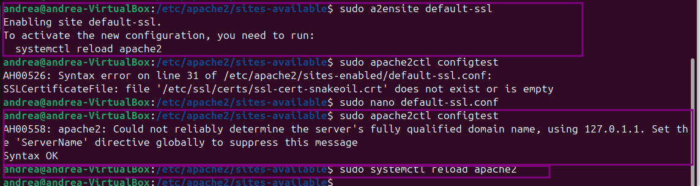

Para hacerlo con Certbot hay que instalarlo

sudo apt update

- sudo apt install python3-certbot-apache

!()[https://github.com/WishMoment/PortfolioDespliegue/blob/main/EjerciciosUD3/311_7.png]

Generarlo y seguir los pasos para que se pueda anclar a un dominio en concreto

- sudo certbot --apache

!()[https://github.com/WishMoment/PortfolioDespliegue/blob/main/EjerciciosUD3/311_8.png]

Como caduca, hay que poner que vaya renovando

- sudo systemctl status certbot.timer

Por si acaso, el archivo necesario para que el VirtualHost se ejecute tiene que ser este

Podemos adaptar el Host 80 (El del Http para poder redirigir)

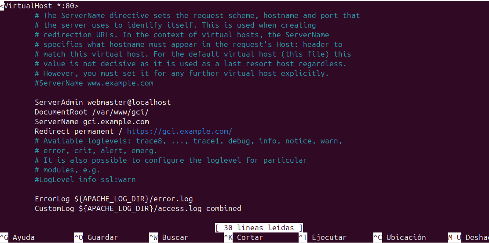

Activamos el sítio

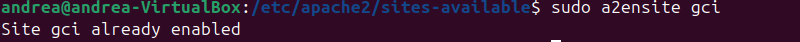

reiniciamos apache

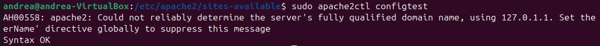

Reiniciar/recargar Apache y validar la correcta implementación mediante navegador o curl.

Lo hacemos con curl porque el navegador puede dar errores

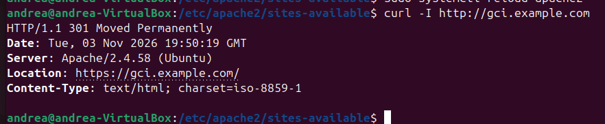

Si pone que se ha movido permanentemente es que ha funcionado.

Con el navegador:

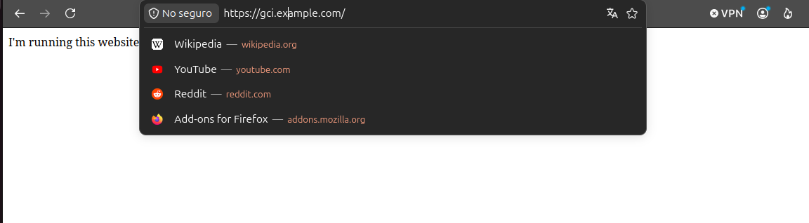
