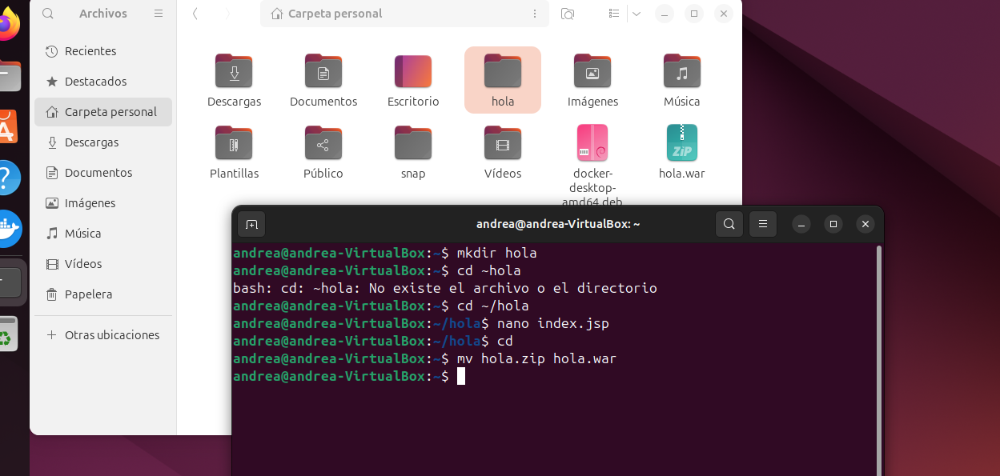
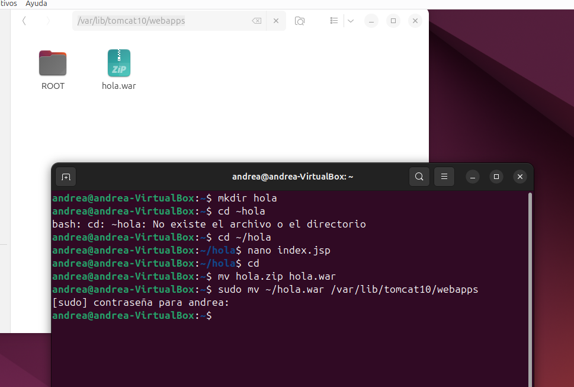
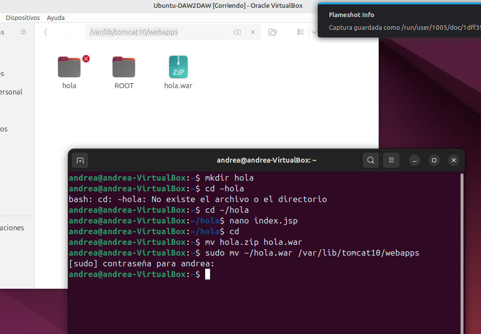
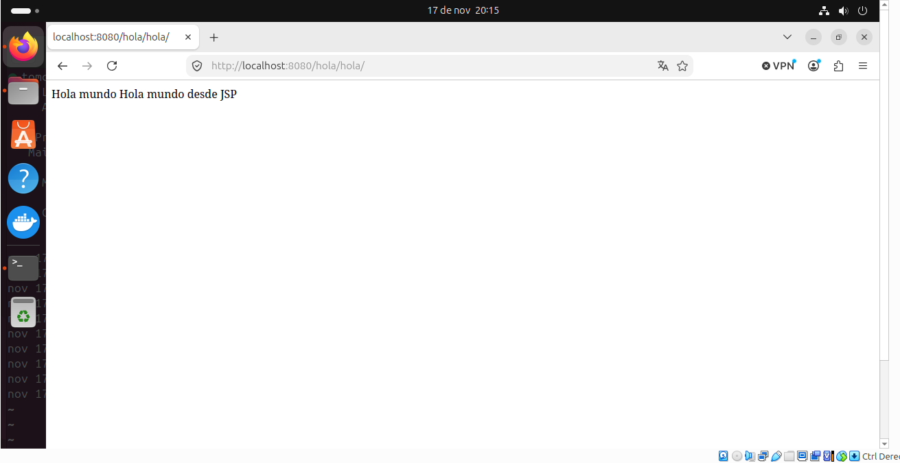

### Instalación
Para hacer el war tenemos que ejecutar lo siguiente:
1. mkdir hola
2. cd ~hola
3. cd ~/hola
4. nano index.jsp
   > Aquí haremos un HTML simple como podría ser
```
<html>
     <head>
       Hola mundo
     </head>
     <body> Hola Mundo desde jsp</body>
</html>
```
4. cd
5. mv hola.zip hola.war





Paso 3: ¿Qué hace Tomcat internamente en Ubuntu de forma automática?
En cuanto el servicio detecta el archivo .war en esa ruta, realiza lo siguiente en milisegundos:

Monitoreo: El gestor interno de Tomcat (Host) detecta la aparición del archivo hola.war.

Descompresión: Descomprime automáticamente el archivo creando la carpeta /var/lib/tomcat9/webapps/hola/.

Traducción y Compilación: Lee el archivo index.jsp, lo traduce a código fuente en Java y luego lo compila en un archivo .class dentro de la caché interna de Tomcat (/var/cache/tomcat9/...).

Enrutamiento: Registra el contexto para que responda bajo la URL /hola.
