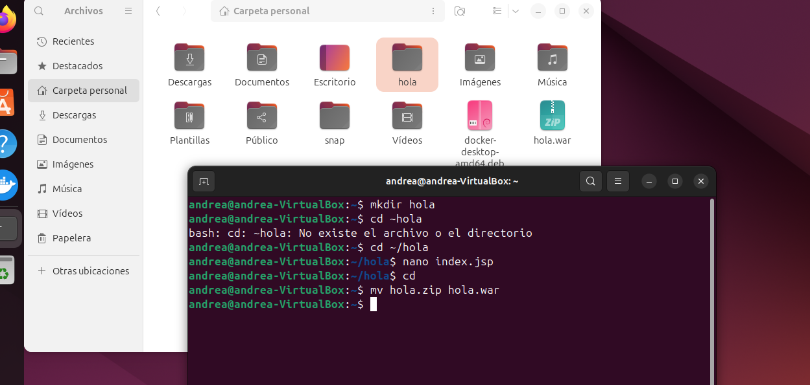
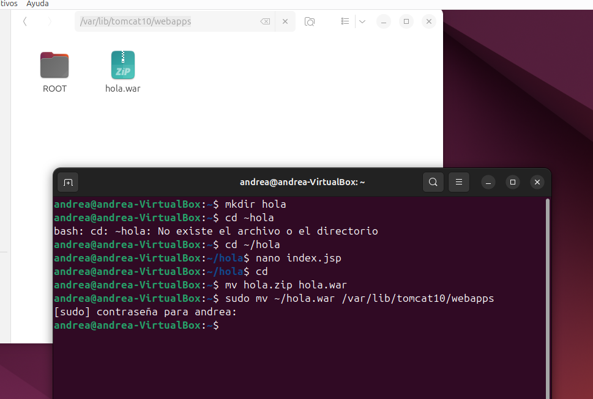
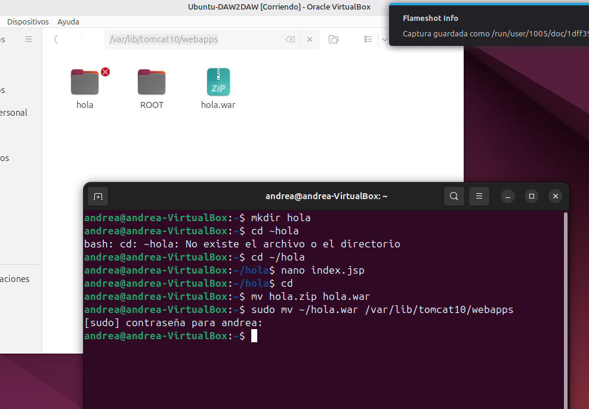
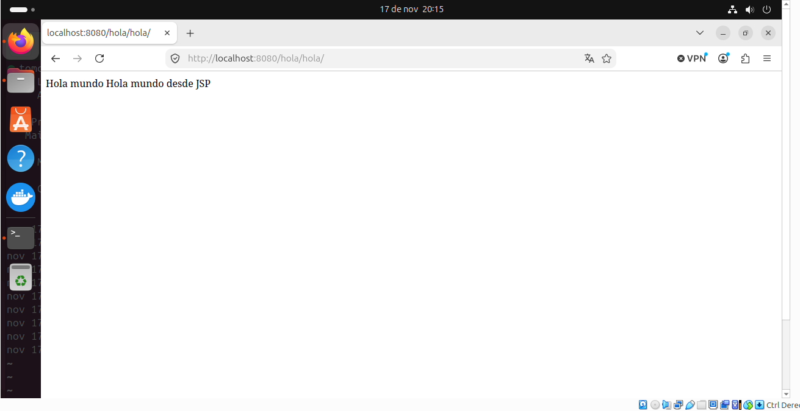

Instala Apache en tu máquina virtual, si no está ya instalado.
Configura un conector AJP o un reverse proxy hacia Tomcat.
Verifica que la aplicación web responde a través del servidor web.
Documenta los pasos realizados
