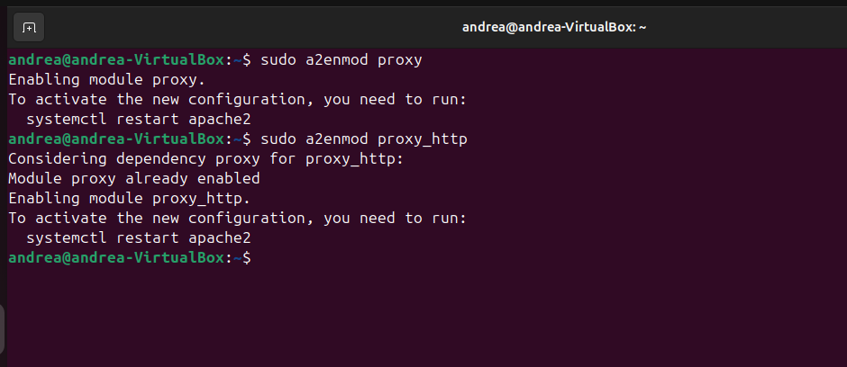
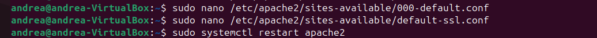
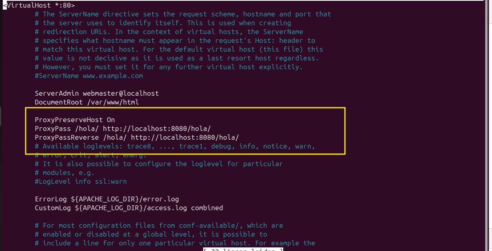
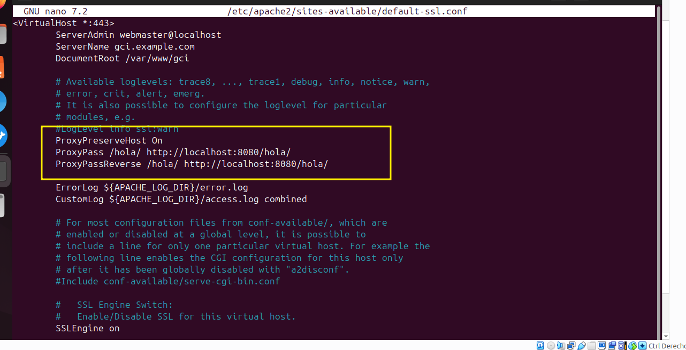
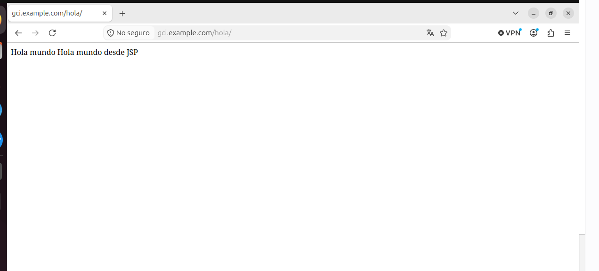

sudo a2enmod proxy
sudo a2enmod proxy_http

sudo nano /etc/apache2/sites-available/000-default.conf
sudo nano /etc/apache2/sites-available/default.ssl.conf

ProxyPreserveHost On
ProxyPass /hola/ http://localhost:8080/hola/
ProxyPassReverse /hola/ http://localhost:8080/hola/

Instala Apache en tu máquina virtual, si no está ya instalado.
Configura un conector AJP o un reverse proxy hacia Tomcat.
Verifica que la aplicación web responde a través del servidor web.
Documenta los pasos realizados
